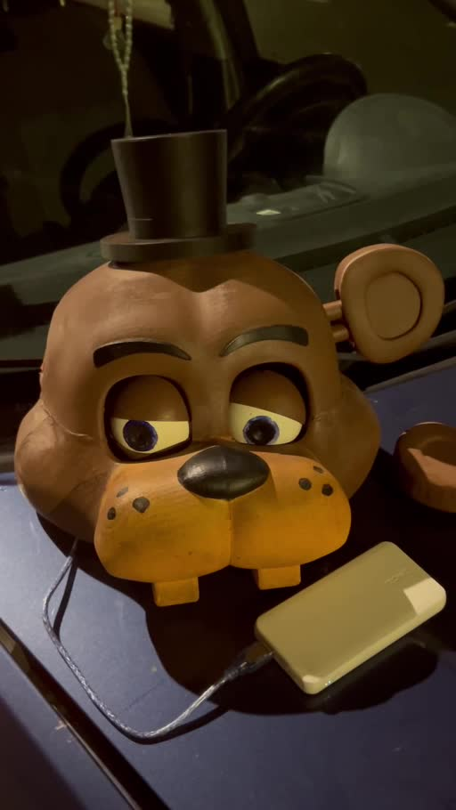
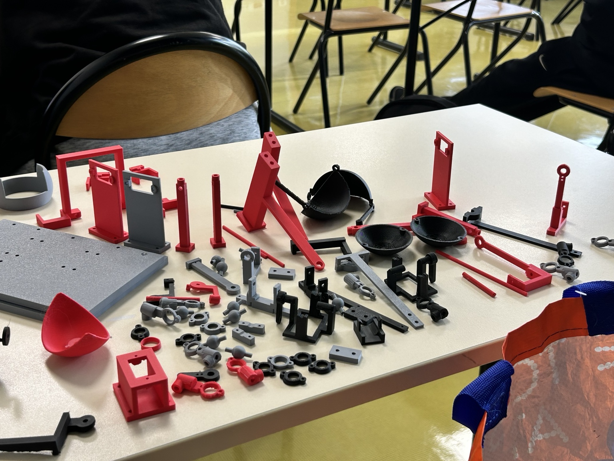

# Portfolio — Tête animatronique Freddy

Un projet personnel à la croisée de la fabrication 3D, de la mécanique et de l’électronique : adapter un masque existant, fabriquer ses pièces, animer les yeux et les paupières, puis réaliser les finitions.

**Élève ingénieur à l’ENSEA — recherche de stage de 16 semaines à partir d’avril 2027**, en génie électrique ou R&D dans l’animatronique et les attractions.

## Démonstrations

- [Tête assemblée : yeux et paupières en mouvement](media/tete-finale.mp4)
- [Mécanisme des yeux : essai sur platine](media/mecanisme-yeux.mp4)

Les vidéos présentent le prototype en fonctionnement. Le développement du projet se poursuit.

## Démarche de fabrication

| Étape | Travail réalisé |
| --- | --- |
| Adaptation du modèle | Remise à l’échelle sous Blender et ajout de goupilles d’assemblage sur la mâchoire inférieure. |
| Impression et assemblage | Fabrication des éléments séparés, assemblage brut et essai porté pour vérifier les dimensions. |
| Animation du regard | Assemblage de globes oculaires, paupières, rotules et supports de servomoteurs sur une platine. |
| Finition | Ponçage, masquage, peinture aérosol et retouches à la main. |

Les deux yeux bougent indépendamment et les paupières sont animées par des servomoteurs. L’ensemble fonctionne sur batterie USB.

## Le site portfolio

Site statique en français, adapté aux écrans mobiles et ordinateurs. Deux démonstrations sélectionnables et des images agrandissables permettent d’explorer le projet.

- `index.html` : présentation et contenu du portfolio.
- `style.css` : mise en page et couleurs.
- `script.js` : sélection des vidéos et galerie.
- `media/` : photos et vidéos du projet.

Aucune installation ni compilation nécessaire. Pour une consultation locale, télécharger le dépôt, le décompresser et ouvrir `index.html`. Les polices Google Fonts nécessitent Internet ; des polices système prennent le relais hors ligne.

### Activer GitHub Pages

Dans **Settings → Pages**, choisir **Deploy from a branch**, puis **main** et **/(root)**, et cliquer sur **Save**. GitHub affichera l’adresse du site après le déploiement.

[Ouvrir les réglages Pages de ce dépôt](https://github.com/yderkaoui0123-tech/portfolio-animatronics-freddy-/settings/pages)

[Documentation officielle GitHub Pages](https://docs.github.com/fr/pages/getting-started-with-github-pages/configuring-a-publishing-source-for-your-github-pages-site)

## Crédits

Masque de départ : « Glamrock Freddy Wearable Mask with Hinged Jaw » de **Gabgra11**, adapté dans Blender. Personnage : *Five Nights at Freddy’s* © Scott Cawthon. Projet de fan, non commercial.

Les photos et vidéos documentent le projet. Ce dépôt présente le portfolio ; il ne contient pas les fichiers 3D sources ni le code de pilotage des servomoteurs. Aucune licence sur le personnage ou le modèle d’origine n’est accordée par ce dépôt.
